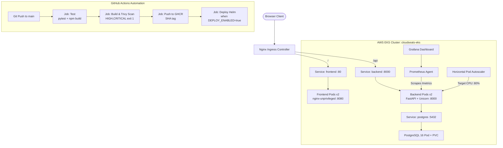

# CloudSeats — SaaS License & Seat Management Platform

[](https://github.com/ManavPratapSingh/cloudseats-devops-capstone/actions)

**CloudSeats** is a production-grade B2B SaaS platform engineered for DevOps and Platform teams to track, provision, and allocate software subscriptions, cloud licenses, and developer seat quotas across an enterprise.

Built as the comprehensive **DevOps Final Capstone Project** (100/100 points across Modules M1–M10), demonstrating full-lifecycle containerized deployment from developer laptop to an observable, auto-scaling AWS EKS Kubernetes cluster.

---

## 1. System Architecture



---

## 2. Tech Stack

| Layer | Technologies | Key Design Features |
|---|---|---|
| **Frontend** | React 18, Vite 5, Plain CSS | Responsive SaaS dashboard, status pill badges, interactive modals, inline 409 conflict notifications. |
| **Backend** | FastAPI, Python 3.12, Pydantic v2 | Non-root container (`UID 10001`), derived status calculation, dual-enforced non-negative quota constraints. |
| **Database** | PostgreSQL 16, SQLAlchemy 2, Alembic | Schema migrations, indexed SKU uniqueness, database `CHECK (quantity >= 0)`. |
| **Testing** | Pytest, TestClient, In-Memory SQLite | 15 automated test cases, isolated SQLite with `StaticPool`, zero PostgreSQL test dependencies. |
| **Containers** | Docker, Docker Compose, Multi-stage builds | Non-root Nginx (`nginx-unprivileged`), dependency caching, minimal image attack surface. |
| **CI/CD** | GitHub Actions, Trivy, GHCR | Automated pytest, npm compilation, Trivy container CVE gate, SHA-tagged image pushing, gated Helm deployment. |
| **IaC** | Terraform (AWS Provider ~> 5.0) | Multi-line HCL, AWS VPC with 2 AZs, public/private subnets, managed EKS cluster with `t3.medium` nodes. |
| **Kubernetes** | Helm 3, Ingress-Nginx, HPA | Helm chart with backend, frontend, postgres, readiness/liveness probes, CPU auto-scaling, resource limits. |
| **Observability** | Prometheus, Grafana, PromQL | `/metrics` endpoint via `prometheus-fastapi-instrumentator`, custom counter `units_issued_total`, Grafana ConfigMap dashboard. |

---

## 3. Business Rule & Domain Model

- **Entity**: `Item` representing a SaaS Subscription / License Resource.
  - `id`: Unique identifier (Primary Key)
  - `name`: Subscription title (e.g. *GitHub Enterprise*, *Datadog Pro*)
  - `sku`: Unique license identifier (e.g. `LIC-GH-001`, duplicate returns `409 Conflict`)
  - `category`: Department category (*Engineering*, *Security*, *DevOps*, *Design*)
  - `quantity`: Number of available seats (integer, non-negative)
  - `reorder_level`: Buffer threshold triggering reorder warnings
  - `location`: Department / Region / Workspace
  - `created_at`: UTC timestamp
- **Derived Status Calculation** (computed dynamically, never stored redundantly):
  - `OUT_OF_STOCK`: When `quantity == 0` (0 seats remaining)
  - `LOW`: When `quantity <= reorder_level` (buffer threshold reached)
  - `IN_STOCK`: When `quantity > reorder_level` (healthy buffer)
- **Non-Negative Stock Rule**:
  - `POST /api/items/{id}/issue` allocates seats to users or teams.
  - If requested allocation exceeds available seats, the system rejects the operation with `409 Conflict`:
    `{"detail": "Cannot issue X units: only Y available"}`.
  - Enforced twice: (1) friendly application check in FastAPI, (2) database `CHECK (quantity >= 0)` constraint protecting against race conditions.

---

## 4. API Specification

| Method | Endpoint | Description | Status Code |
|---|---|---|---|
| `GET` | `/` | Service root and metadata | `200 OK` |
| `GET` | `/health` | Liveness probe (instant, no DB check) | `200 OK` |
| `GET` | `/ready` | Readiness probe (verifies database `SELECT 1`) | `200 OK` |
| `GET` | `/metrics` | Prometheus metrics and business counter | `200 OK` |
| `GET` | `/api/items/stats` | Aggregated counts by derived status | `200 OK` |
| `GET` | `/api/items` | List subscriptions (supports `?status=` and `?category=`) | `200 OK` |
| `GET` | `/api/items/{id}` | Retrieve single subscription by ID | `200 OK` / `404 Not Found` |
| `POST` | `/api/items` | Provision new SaaS subscription (rejects duplicate SKU) | `201 Created` / `409 Conflict` |
| `PUT` | `/api/items/{id}` | Update subscription details | `200 OK` / `404 Not Found` / `409 Conflict` |
| `DELETE` | `/api/items/{id}` | Revoke and delete subscription | `204 No Content` / `404 Not Found` |
| `POST` | `/api/items/{id}/issue` | Allocate seats (rejects over-allocation) | `200 OK` / `409 Conflict` |

---

## 5. Local Development (Docker Compose)

Run the entire application stack locally with a single command:

```bash
# 1. Start Postgres, FastAPI backend, and React frontend
docker compose up -d --build

# 2. Verify container status and non-root execution
docker compose ps
docker compose exec backend id   # confirms uid=10001(appuser)

# 3. Access applications in your browser
# Frontend:  http://localhost:3000
# Backend:   http://localhost:8000
# OpenAPI:   http://localhost:8000/docs
# Metrics:   http://localhost:8000/metrics

# 4. Stop and clean up containers
docker compose down -v
```

---

## 6. Automated Testing (Pytest)

The test suite runs against an isolated, in-memory SQLite database using SQLAlchemy's `StaticPool`. It never contacts PostgreSQL.

```bash
cd backend
pytest -v
```

All 15 tests execute and pass in under 0.5 seconds:
```text
backend/tests/test_api.py::test_root_endpoint PASSED                     [  6%]
backend/tests/test_api.py::test_health_endpoint PASSED                   [ 13%]
backend/tests/test_api.py::test_ready_endpoint PASSED                    [ 20%]
backend/tests/test_api.py::test_metrics_endpoint_format PASSED           [ 26%]
backend/tests/test_api.py::test_create_item_success PASSED               [ 33%]
backend/tests/test_api.py::test_create_item_duplicate_sku_conflict PASSED [ 40%]
backend/tests/test_api.py::test_create_item_validation_error PASSED      [ 46%]
backend/tests/test_api.py::test_get_item_by_id PASSED                    [ 53%]
backend/tests/test_api.py::test_get_item_unknown_not_found PASSED        [ 60%]
backend/tests/test_api.py::test_list_items_with_category_and_status_filter PASSED [ 66%]
backend/tests/test_api.py::test_issue_stock_success PASSED               [ 73%]
backend/tests/test_api.py::test_issue_stock_insufficient_conflict PASSED [ 80%]
backend/tests/test_api.py::test_update_item_success_and_conflict PASSED  [ 86%]
backend/tests/test_api.py::test_delete_item_success_then_404 PASSED      [ 93%]
backend/tests/test_api.py::test_stats_counts PASSED                      [100%]
======================== 15 passed, 1 warning in 0.28s =========================
```

---

## 7. Infrastructure Provisioning (Terraform)

Deploy the AWS VPC and EKS cluster in `ap-south-1`:

```bash
cd terraform
cp terraform.tfvars.example terraform.tfvars
terraform init
terraform fmt -check
terraform validate
terraform plan -out=tfplan
terraform apply tfplan

# Configure kubectl
aws eks update-kubeconfig --region ap-south-1 --name cloudseats-eks
kubectl get nodes
```

---

## 8. Kubernetes & Helm Deployment

Deploy CloudSeats to Kubernetes with rolling update capability:

```bash
# 1. Create namespace
kubectl apply -f k8s/namespace.yaml

# 2. Lint and deploy chart
helm lint ./helm/cloudseats
helm upgrade --install cloudseats ./helm/cloudseats \
  -n cloudseats \
  -f ./helm/cloudseats/values-dev.yaml \
  --set backend.tag=latest \
  --set frontend.tag=latest

# 3. Verify running pods (2 replicas each)
kubectl get pods -n cloudseats
kubectl get svc -n cloudseats
kubectl get ingress -n cloudseats
```

---

## 9. Observability & Monitoring

```bash
# 1. Install kube-prometheus-stack
helm repo add prometheus-community https://prometheus-community.github.io/helm-charts
helm repo update
helm upgrade --install prometheus prometheus-community/kube-prometheus-stack \
  -n monitoring --create-namespace \
  -f monitoring/prometheus-values.yaml

# 2. Apply Grafana Dashboard ConfigMap
kubectl apply -f monitoring/grafana-dashboard.yaml

# 3. Run concurrent traffic generator to stimulate metrics and HPA
./scripts/load-test.sh http://localhost:8000/api/items
```

---

## 10. Submission Screenshot Checklist

- [ ] **M2**: Terminal output of `pytest -v` passing all 15 tests.
- [ ] **M3**: Git commit log showing 15+ conventional commits (`git log --oneline`).
- [ ] **M4**: Docker compose output and browser running at `http://localhost:3000`.
- [ ] **M5**: Green GitHub Actions pipeline run URL with `test` and `build-scan-push` jobs.
- [ ] **M6**: Trivy vulnerability scan output showing zero unfixed `HIGH` or `CRITICAL` CVEs.
- [ ] **M7**: AWS Console screenshots showing VPC and EKS cluster in `ap-south-1`.
- [ ] **M8**: `kubectl get pods -n cloudseats`, `kubectl get svc -n cloudseats`, and browser via Ingress.
- [ ] **M9**: Prometheus Targets page showing backend **UP**, and Grafana dashboard populated with PromQL metrics.
- [ ] **M10**: Live presentation or demo walkthrough recorded per `docs/DEMO.md`.
